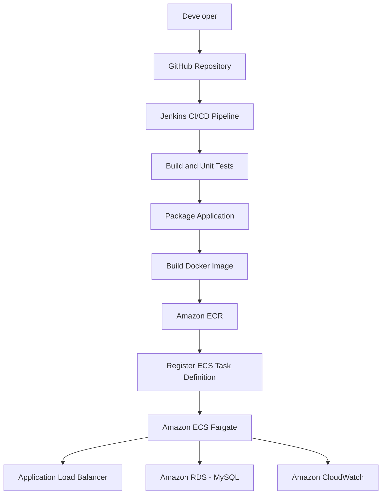

# Employee Management System – Automated CI/CD Pipeline on AWS

A containerized Employee Management System built using **Java 17, Spring Boot, MySQL, Docker, Jenkins, and AWS**. This project demonstrates an end-to-end CI/CD pipeline that automates application compilation, unit testing, packaging, Docker image creation, Amazon ECR publishing, and deployment to Amazon ECS Fargate.

## Project Overview

The Employee Management System is a RESTful backend application that allows users to perform CRUD (Create, Read, Update, Delete) operations on employee records.

The application is built using Spring Boot and MySQL. It is containerized using Docker and deployed on AWS using an automated Jenkins CI/CD pipeline.

## Architecture



## Technologies Used

| Category | Technologies |
|---|---|
| Programming Language | Java 17 |
| Framework | Spring Boot 3.5.7 |
| Database | MySQL 8.0 |
| ORM | Spring Data JPA, Hibernate |
| Build Tool | Maven |
| Unit Testing | JUnit 5, Mockito |
| Containerization | Docker, Docker Compose |
| CI/CD | Jenkins |
| Container Registry | Amazon ECR |
| Container Orchestration | Amazon ECS |
| Compute | AWS Fargate |
| Database Hosting | Amazon RDS |
| Load Balancing | Application Load Balancer |
| Secrets Management | AWS Secrets Manager |
| Logging | Amazon CloudWatch |
| Source Control | Git, GitHub |

## Application Features

- Create new employee records.
- Retrieve all employees.
- Retrieve an employee by ID.
- Update existing employee information.
- Delete employee records.
- Store employee information in a MySQL database.
- Use a layered architecture to separate application responsibilities.

## Application Architecture

The application follows a layered architecture:

```text
EmployeeController
       |
       v
EmployeeService
       |
       v
EmployeeServiceImpl
       |
       v
EmployeeRepository
       |
       v
MySQL Database
```

### Main Components

- **EmployeeController:** Handles HTTP requests and exposes REST API endpoints.
- **EmployeeService:** Defines employee-related business operations.
- **EmployeeServiceImpl:** Implements the business logic.
- **EmployeeRepository:** Uses Spring Data JPA to interact with the database.
- **Employee:** Entity representing employee records.

## REST API Endpoints

Base endpoint: `/api/employees`

| HTTP Method | Endpoint | Description |
|---|---|---|
| POST | `/api/employees` | Create an employee |
| GET | `/api/employees` | Retrieve all employees |
| GET | `/api/employees/{id}` | Retrieve employee by ID |
| PUT | `/api/employees/{id}` | Update employee details |
| DELETE | `/api/employees/{id}` | Delete an employee |

### Sample Request

**POST `/api/employees`**

```json
{
  "name": "Rahul",
  "email": "rahul@gmail.com",
  "department": "IT",
  "salary": 60000
}
```

## Docker Implementation

The application is containerized using a multi-stage Dockerfile.

### Build Stage

- Uses Maven 3.9.9 with Eclipse Temurin JDK 17.
- Copies the Maven configuration and application source code.
- Packages the Spring Boot application.

### Runtime Stage

- Uses the Eclipse Temurin Java 17 JRE image.
- Copies the packaged application JAR from the build stage.
- Exposes port 8080.
- Starts the Spring Boot application.

Docker Compose is configured to run the application and MySQL database locally.

It includes:
- A MySQL 8.0 container.
- An application container.
- A health check to verify MySQL readiness.
- A named Docker volume for persistent MySQL data.
- Environment variables for database configuration.

## Jenkins CI/CD Pipeline

Jenkins automates the build, test, packaging, containerization, and deployment process.

### Pipeline Stages

1. **Checkout:** Retrieves the application source code from GitHub.
2. **Build:** Compiles the application using Maven.
3. **Unit Tests:** Executes JUnit 5 and Mockito service unit tests.
4. **Package Application:** Packages the Spring Boot application.
5. **Build Docker Image:** Builds a Docker image using the project Dockerfile.
6. **Verify AWS Identity:** Verifies the AWS IAM identity used by Jenkins.
7. **Login to ECR:** Authenticates Docker with Amazon ECR.
8. **Push Image to ECR:** Tags and pushes the Docker image using the Jenkins build number.
9. **Register ECS Task Definition:** Retrieves the current task definition, updates the container image, and registers a new revision.
10. **Deploy to ECS:** Updates the ECS service to use the new task definition and monitors deployment status.

### Pipeline Automation Highlights

- Uses the Jenkins build number as the Docker image tag.
- Uses an EC2 IAM role for AWS authentication.
- Uses Amazon ECR to store application images.
- Uses AWS CLI and `jq` to update ECS task definitions.
- Monitors ECS deployment status, running tasks, and rollout state.
- Publishes JUnit test reports in Jenkins.

## AWS Infrastructure

The application is deployed using the following AWS services:

| AWS Service | Purpose |
|---|---|
| Amazon EC2 | Hosts the Jenkins server |
| Amazon ECR | Stores Docker images |
| Amazon ECS | Manages container deployment |
| AWS Fargate | Runs containers without managing EC2 worker nodes |
| Amazon RDS | Hosts the MySQL database |
| Application Load Balancer | Distributes incoming application traffic |
| AWS Secrets Manager | Stores database credentials |
| AWS IAM | Controls access to AWS resources |
| Amazon CloudWatch | Collects container application logs |

### Deployment Workflow

1. Jenkins checks out the source code from GitHub.
2. Maven compiles and tests the application.
3. Jenkins packages the Spring Boot application.
4. Docker builds a container image.
5. Jenkins authenticates with Amazon ECR and pushes the image.
6. Jenkins registers a new ECS task definition revision with the updated image.
7. Jenkins updates the ECS service.
8. ECS runs the application container using AWS Fargate.
9. The Application Load Balancer routes incoming HTTP requests to the application.
10. The application connects to the MySQL database hosted on Amazon RDS.
11. Application logs are collected in Amazon CloudWatch.

Database credentials are provided to the ECS task through AWS Secrets Manager rather than being hardcoded in the application.

## Running Locally

### Prerequisites

- Java 17
- Maven
- MySQL 8.0

For containerized execution:
- Docker
- Docker Compose

### Option 1: Run Using Maven

Clone the repository:

```bash
git clone https://github.com/Raksh315/employee-management-system.git
cd employee-management-system
```

Create the database in MySQL:

```sql
CREATE DATABASE employee_db;
```

Configure the following environment variables before starting the application:

```text
DB_URL=jdbc:mysql://localhost:3306/employee_db
DB_USERNAME=your_mysql_username
DB_PASSWORD=your_mysql_password
```

Build the application:

```bash
mvn clean package
```

Run the application:

```bash
mvn spring-boot:run
```

The application will be available at:

```text
http://localhost:8080
```

### Option 2: Run Using Docker Compose

Create a `.env` file in the project root:

```env
MYSQL_ROOT_PASSWORD=your_root_password
MYSQL_APP_PASSWORD=your_application_password
```

Start the application and database containers:

```bash
docker compose up --build -d
```

The application will be available at:

```text
http://localhost:8081
```

To check running containers:

```bash
docker compose ps
```

To view application logs:

```bash
docker compose logs -f app
```

To stop the containers:

```bash
docker compose down
```

The named MySQL volume is retained when containers are stopped. To remove the database volume as well, use `docker compose down -v` (this permanently removes the local database volume).

**Note:** Do not commit the `.env` file. It contains local credentials.

## Running Unit Tests

The project uses JUnit 5 and Mockito to test the service layer.

Run the service unit tests using:

```bash
mvn -B -Dtest=EmployeeServiceImplTest test
```

The service tests cover:

- Creating an employee.
- Retrieving all employees.
- Retrieving an employee by ID.
- Handling an employee ID that does not exist.
- Updating employee details.
- Deleting an employee.

## Project Structure

```text
employee-management-system/
│
├── src/
│   ├── main/
│   │   ├── java/com/shubha/employeemanagementsystem/
│   │   │   ├── controller/
│   │   │   │   └── EmployeeController.java
│   │   │   ├── entity/
│   │   │   │   └── Employee.java
│   │   │   ├── repository/
│   │   │   │   └── EmployeeRepository.java
│   │   │   ├── service/
│   │   │   │   ├── EmployeeService.java
│   │   │   │   └── impl/
│   │   │   │       └── EmployeeServiceImpl.java
│   │   │   └── EmployeeManagementSystemApplication.java
│   │   │
│   │   └── resources/
│   │       ├── application.properties
│   │       └── api.http
│   │
│   └── test/
│       └── java/com/shubha/employeemanagementsystem/
│           └── service/impl/
│               └── EmployeeServiceImplTest.java
│
├── Dockerfile
├── docker-compose.yml
├── Jenkinsfile
├── pom.xml
├── mvnw
├── mvnw.cmd
└── README.md
```

## Key Learning Outcomes

- Developing REST APIs using Spring Boot.
- Implementing layered application architecture.
- Integrating MySQL using Spring Data JPA.
- Writing unit tests using JUnit 5 and Mockito.
- Building multi-stage Docker images.
- Running multi-container applications using Docker Compose.
- Automating CI/CD workflows using Jenkins.
- Publishing Docker images to Amazon ECR.
- Deploying containerized applications using Amazon ECS Fargate.
- Integrating AWS RDS, IAM, Secrets Manager, and CloudWatch.
- Automating ECS task-definition registration and service deployment.

## Author

**Rakshitha S**

GitHub: [Raksh315](https://github.com/Raksh315)